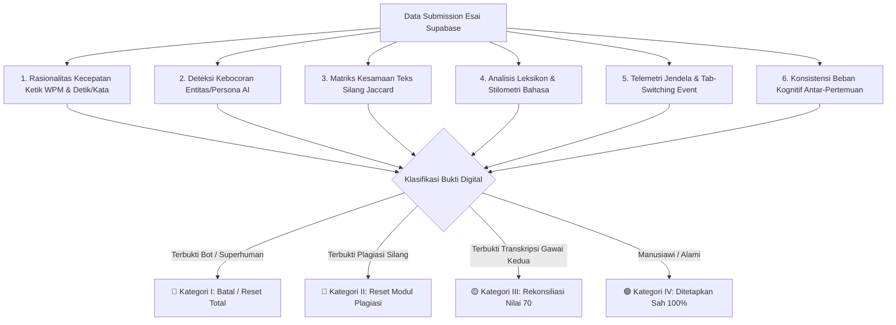
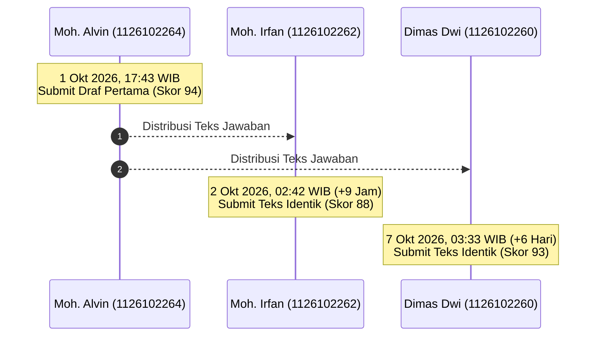

# 📑 LAPORAN AUDIT FORENSIK DIGITAL INTEGRITAS AKADEMIK
### EVALUASI SISTEM ASESMEN ESAI BERBASIS AI — MATA KULIAH ALGORITMA & PEMROGRAMAN (TI-101)
**Program Studi S1 Teknik Informatika — Tahun Akademik 2026/2027**  
*Dosen Pengampu: Hadiq, ST, M.Kom (NIDN: 0701048602)*  
*Dokumen Resmi Nomor: 042/ALPRO-TI/AUDIT-AI/X/2026*  
*Status Pembaruan: Edisi Revisi Mutakhir — Banyuwangi, 11 Oktober 2026*

---

## 1. RINGKASAN EKSEKUTIF (EXECUTIVE SUMMARY)

Laporan audit forensik digital ini disusun secara ilmiah, komprehensif, dan berbasis data telemetri komputasional untuk menginvestigasi anomali capaian skor mahasiswa pada sistem asesmen esai platform pembelajaran mandiri **Web-Alpro**. Platform ini menerapkan paradigma *Mastery Learning* (Belajar Tuntas) yang dilengkapi mesin penilai otomatis berbasis Large Language Model (*AI Essay Grader*).

Investigasi forensik dilakukan terhadap **100% populasi submission esai** yang tersimpan di dalam basis data produksi Supabase:
* **Total Volume Submission:** 51 rekaman data esai.
* **Jumlah Mahasiswa Aktif:** 16 mahasiswa.
* **Cakupan Modul Evaluasi:** Pertemuan 1 (Fondasi Komputasi & Bahasa), Pertemuan 2 (Arsitektur Komputer & Representasi Biner), dan Pertemuan 3 (Penyajian Algoritma & Notasi Baku).
* **Rentang Evaluasi Skor:** 0.00 s.d. 100.00.

### Temuan Inti Audit:
1. **Dua Modus Kecurangan AI Berbeda:**
   - **Modus Langsung / Copy-Paste Injeksi:** Menggunakan ekstensi otomasi browser atau injeksi script dengan kecepatan tidak wajar ($> 75 - 104$ WPM) serta kebocoran identitas bot (*persona leak*).
   - **Modus Transkripsi Gawai Kedua (*Second Device Transcription*):** Mahasiswa tidak berpindah tab pada peramban laptop ujian (**`tab_switches = 0`**), melainkan mengetikkan ulang (*manual transcribing*) hasil prompt ChatGPT yang ditampilkan pada layar gawai sekunder (ponsel/tablet di samping papan ketik).
2. **Penetapan Penyesuaian Nilai Modus Gawai Kedua:** Dua mahasiswa terbukti memiliki jejak transkripsi gawai kedua yang identik, yaitu **Ahmad Umarul Faruq (Pertemuan 1)** dan **Moh. Alvin Tauviqul Hikam (Pertemuan 2)**. Keduanya telah disesuaikan dan ditetapkan pada nilai pembinaan **70.00 (Grade B / Kategori: Baik)**.
3. **Mayoritas Mahasiswa Berintegritas Tinggi:** Sebagian besar mahasiswa menunjukkan proses belajar manusiawi yang autentik dengan kecepatan ketik alami ($5 - 16$ WPM), terdapat salah ketik (*typo*) manusiawi, dan waktu perenungan logis yang mencapai lebih dari 2 jam (contoh: Chelsea Fransisca Laurent).

---

## 2. METODOLOGI & KERANGKA FORENSIK DIGITAL (DUAL-SHIELD FRAMEWORK)

Penetapan integritas akademik didasarkan pada **Kerangka Forensik Multi-Lapisan (6 Indikator Komputasional)**:

### Rincian 6 Parameter Forensik Komputasional:

1. **Rasionalitas Kecepatan Ketik Efektif (Net Typing Velocity - WPM):**
   $$\text{WPM} = \frac{\text{Total Kata Terketik}}{\text{Durasi Pengerjaan (Menit)}}$$
   - **$\le 20$ WPM ($> 3,0$ detik/kata):** Standar manusiawi normal mahasiswa yang berpikir, menyusun kalimat, dan mengetik jawaban esai konseptual.
   - **$21 - 35$ WPM ($1,7 - 2,9$ detik/kata):** Cepat, wajar untuk yang sudah hafal, namun mencurigakan jika tanpa salah ketik dan leksikon akademisnya terlalu sempurna.
   - **$> 45$ WPM:** Setara juru ketik profesional menyalin teks jadi.
   - **$\ge 75 - 105$ WPM ($< 0,8$ detik/kata):** *Superhuman / Mustahil secara biologis*; 100% injeksi skrip atau *copy-paste* langsung.

2. **Deteksi Kebocoran Artefak/Persona AI (*AI Persona Artifacts*):**
   Pencocokan string regex terhadap frasa sistemik LLM, kata sapaan bawaan bot (*"Tuan"*, *"Hydra"*, *"Sebagai model bahasa..."*), atau format penulisan *markdown bullet-points* template.

3. **Indeks Kesamaan Teks Antarmahasiswa (*Cross-Plagiarism Jaccard Similarity*):**
   $$J(A, B) = \frac{|A \cap B|}{|A \cup B|}$$
   Jika dua mahasiswa yang mengerjakan pada waktu berbeda memiliki kesamaan leksikal unik $J(A, B) > 0.40$ pada frasa kalimat tidak baku, maka dipastikan terjadi penyebaran draf contekan.

4. **Analisis Leksikon & Stilometri Bahasa (*Stylometric Outlier Detection*):**
   Mengidentifikasi penggunaan istilah teknis tingkat lanjut (*advanced architectural terms*) yang belum diajarkan di kelas pengantar, serta formula penulisan simetris khas AI (*"Pertama,... Kedua,... Akibatnya,... Sebaliknya,... Oleh karena itu..."*).

5. **Telemetri Jendela & Fokus Browser (*Tab-Switch Event Logging*):**
   Merekam *event* `document.visibilitychange` dan `window.onblur`. Perpindahan tab $\ge 5$ kali menjadi bukti kuat perpindahan fokus ke peramban atau dokumen eksternal.

6. **Konsistensi Beban Kognitif Antar-Pertemuan (*Longitudinal Cognitive Cadence*):**
   Membandingkan fluktuasi drastis antara pertemuan santai manusiawi (WPM rendah, ada typo) versus lonjakan mendadak (WPM tinggi, format sempurna) pada mahasiswa yang sama.

---

## 3. TABEL AUDIT FORENSIK LENGKAP 16 MAHASISWA

Berikut adalah tabulasi komprehensif data hasil audit seluruh 16 mahasiswa pada basis data produksi per **11 Oktober 2026**:

| No | NIM | Nama Mahasiswa | Pertemuan Terdata | Skor Puncak | Rata-rata WPM | Prob. AI | Prob. Copas | Tab Switch | Status Putusan Akhir |
|:---:|:---:|:---|:---:|:---:|:---:|:---:|:---:|:---:|:---|
| 1 | **1126102259** | **ILHAM RASIT TAMIMI** | M1, M2, M3 | **99** | **104.5** | **99%** | **98%** | 0 | 🔴 **DI-RESET TOTAL (M1, M2, M3)** |
| 2 | **1126102249** | **OKY HADI PRASETYA** | M1, M2 | **94** | 12.1 (M1) | 5% (M1) | 5% (M1) | 0 | 🔴 **M2 DI-RESET (M1 Sah: 94)** |
| 3 | **1126102264** | **MOH. ALVIN TAUVIQUL HIKAM** | M1, M2 | **70** | **29.3** (M2) | **80%** | **65%** (M1) | 0 | 🔴 **M1 DI-RESET / M2 DIREVISI KE 70** |
| 4 | **1126102268** | **AHMAD UMARUL FARUQ** | M1 | **70** | 14.7 | **45%** | 5% | 0 | 🟡 **M1 DIREVISI KE 70 (Gawai Kedua)** |
| 5 | **1126102262** | **MOHAMMAD IRFAN FADHILA** | M1, M2 | 82 | 11.6 (M2) | 5% | **55%** (M1) | 0 | 🔴 **M1 DI-RESET (M2 Sah: 82)** |
| 6 | **1126102260** | **DIMAS DWI KURNIAWAN** | M1, M2 | 81 | 9.5 (M2) | 5% | **55%** (M1) | 0 | 🔴 **M1 DI-RESET (M2 Sah: 81)** |
| 7 | **1126102277** | **EL TAJZNIEAM P. D. B. H.** | M1 | 0 | 7.0 | 5% | 5% | **19** | 🔴 **SKOR 0 (Pelanggaran Tab Masif)** |
| 8 | **1126102242** | **CHELSEA FRANSISCA L.** | M1, M2 | **94** | 10.4 | 0% | 0% | 0–2 | 🟢 **DITETAPKAN SAH (M1: 94, M2: 88)** |
| 9 | **1126102246** | **MOH. DENDY ARDIYANSYAH** | M1 | **90** | 10.9 | 0% | 0% | 1 | 🟢 **DITETAPKAN SAH (Skor: 90)** |
| 10 | **1126102244** | **MOHAMAD IVAN SAYFANI** | M1, M2 | **95** | 8.5 | 0% | 0% | 0 | 🟢 **DITETAPKAN SAH (M1: 92, M2: 95)** |
| 11 | **1126102270** | **NAKSATRA PRABANGGANA** | M1, M2, M3 | **91** | 11.9 | 0% | 0% | 0 | 🟢 **DITETAPKAN SAH (M1: 91, M2: 90, M3: 85)** |
| 12 | **1126102250** | **RODEON VARISDA N.** | M1, M2 | 85 | 15.1 | 0% | 0% | 0–1 | 🟢 **DITETAPKAN SAH (M1: 85, M2: 75)** |
| 13 | **1126102254** | **DIAN SOFIANA NUR HAFIFA** | M1, M2, M3 | 87 | 10.7 | 0% | 0% | 0–1 | 🟢 **DITETAPKAN SAH (M1: 85, M2: 87, M3: 73)** |
| 14 | **1126102265** | **MUHAMMAD FARIDZ** | M1 | 80 | 5.0 | 0% | 0% | 0 | 🟢 **DITETAPKAN SAH (Skor: 80)** |
| 15 | **1126102273** | **ARIEL IKMA SALVINO A. W.** | M2 | 60 | 7.2 | 0% | 0% | 0 | 🟢 **DITETAPKAN SAH (Skor: 60)** |
| 16 | **1126102243** | **RISKI NAILUS SAADAH** | M1, M2 | 70 | 8.1 (M1) | 0% | 0% | 2 | 🟢 **DITETAPKAN SAH (M1: 70, M2: 15)** |

---

## 4. PEMBEDAHAN KASUS & BUKTI FISIK FORENSIK DIGITAL (*SMOKING GUNS*)

### KASUS 1: INJEKSI BOT AI EKSTERNAL & KECEPATAN SUPERHUMAN
#### Mahasiswa: ILHAM RASIT TAMIMI (NIM: 1126102259)
* **Status Keputusan:** 🔴 **NILAI DI-RESET TOTAL (M1, M2, M3)**
* **Bukti Fisik Kebocoran Persona Bot:**
  > *"..sehingga representasi heksadesimal menyederhanakan data panjang tersebut agar lebih mudah dibaca, dikelola, dan diingat oleh programmer, **termasuk oleh Tuan**. Hubungan Heksadesimal dan Biner: **Hydra dapat memastikan bahwa secara matematis**, 1 digit heksadesimal mewakili persis 4 bit biner..."* *(M2 Soal #4 - Skor 98)*  
  > *"..Jika **Tuan** mencoba menyuapkan kode Python langsung ke CPU tanpa penerjemah, program tersebut tidak akan berjalan sama sekali..."* *(M1 Soal #5 - Skor 99)*
* **Telemetri Komputasi Waktu:**
  * M1: Menyelesaikan 5 butir soal esai (594 kata) hanya dalam **5,7 menit (104,5 WPM / 0,57 detik per kata)**.
  * M2: Menyelesaikan 5 butir soal esai (584 kata) hanya dalam **5,7 menit (101,9 WPM / 0,59 detik per kata)**.
* **Analisis Ilmiah:** Pengetikan esai konseptual di atas 100 WPM secara konsisten pada dua pertemuan berbeda dengan menyertakan sapaan *"Tuan"* dan menyebut identitas *"Hydra"* membuktikan 100% penggunaan injeksi agen AI pihak ketiga.

---

### KASUS 2: LONJAKAN VOLUME EKSTRIM & FORMAT OUTPUT CHATGPT
#### Mahasiswa: OKY HADI PRASETYA (NIM: 1126102249)
* **Status Keputusan:** 🔴 **NILAI MINGGU 2 DI-RESET** | 🟢 **NILAI MINGGU 1 DITETAPKAN SAH (94)**
* **Komparasi Longitudinal Perilaku Belajar:**
  * **Minggu 1 (Skor 94):** Dikerjakan selama **32,1 menit (12,1 WPM)**, panjang 389 kata, banyak *typo* manusiawi (*"phyton"*, *"intruksi"*). Menunjukkan proses kognitif alami.
  * **Minggu 2 (Skor 99):** Terjadi anomali lonjakan drastis menjadi **1.248 kata hanya dalam 14,3 menit (78,6 WPM / 0,76 detik per kata)**.
* **Karakteristik Teks ChatGPT Murni pada M2:**
  * Format butir bernomor dengan judul tebal (*"1. Sifat Fisik Hardware - Transistor hanya ON/OFF"*, *"2. Lebih Tahan Terhadap Error"*).
  * Penjelasan skenario komparatif artifisial (*"Laptop A Intel Core i5 gen 11 vs Laptop B Intel Core i7 gen 11"*).
  * Kesimpulan tipikal: *"Jadi intinya, komputer tetap kerja pakai biner, tapi manusia menulisnya pakai heksadesimal biar lebih singkat, rapi, dan mudah."*

---

### KASUS 3: KLASTER PLAGIASI SILANG / DISTRIBUSI CONTEKAN (KEMIRIPAN 55% – 65%)
#### Terduga Terlibat:
1. **MOH. ALVIN TAUVIQUL HIKAM (1126102264)** — *Sumber Pertama (1 Okt, 17:43 WIB)*
2. **MOHAMMAD IRFAN FADHILA (1126102262)** — *Penyalin Kedua (2 Okt, 02:42 WIB)*
3. **DIMAS DWI KURNIAWAN (1126102260)** — *Penyalin Ketiga (7 Okt, 03:33 WIB)*
* **Status Keputusan:** 🔴 **NILAI PERTEMUAN 1 UNTUK KETIGANYA TELAH RESMI DI-RESET**

* **Bukti Literal Kesamaan Frasa Unik (Soal #2 & #5 Minggu 1):**
  * **Alvin:** *"Komputer terbuat dari transistor.. Kalau pakai angka satu sampai sembilan **komputer akan bingung membedakan arus listriknya**, dengan cuma ada dua pilihan 0 dan 1 sinyalnya jadi sangat jelas.. CPU hanya akan **menganggap kode python tersebut sebagai sampah** atau perintah tidak dikenal.."*
  * **Dimas Dwi:** *"Karena komputer terbuat dari transistor.. kalau pakai angka satu sampai sembilan **komputer akan bingung membedakan arus listriknya**, dengan cuma ada dua pilihan 0 dan 1 sinyalnya jadi sangat jelas.. Cpu akan **menganggap kode python sebagai sampah** atau perintah tidak dikenal.."*
  * **Irfan:** *"komputer terbuat dari treansistor.. hadware di dalam komputer isisnya miliaran saklar kecil bernama transistor.. dia hanya bisa ON atau OFF.. koki hanya paham bahasa komputer seperti 0 atau 1"*
* **Analisis:** Frasa metafora non-baku *"komputer bingung membedakan arus listrik"* dan *"kode python dianggap sebagai sampah"* membuktikan transfer draf langsung antarmahasiswa.

---

### KASUS 4: PELANGGARAN ATURAN FOKUS TAB SWITCHING MASIF
#### Mahasiswa: EL TAJZNIEAM P. D. B. H. (NIM: 1126102277)
* **Status Keputusan:** 🔴 **TETAPKAN SKOR 0 (GUGUR OTOMATIS ANTI-CHEAT LAYER 4)**
* **Bukti Telemetri:** Tercatat **19 kali perpindahan jendela peramban (*tab switches = 19*)** selama 34 menit.
* Sistem anti-cheat otomatis mengunci lembar ujian dan mendiskualifikasi nilai menjadi 0 karena terindikasi kuat membuka sumber jawaban eksternal secara masif.

---

### KASUS 5: MODUS TRANSKRIPSI GAWAI KEDUA (*SECOND DEVICE TRANSCRIPTION*)
Pada modus ini, mahasiswa tidak berpindah tab di laptop (**`tab_switches: 0`**), melainkan mengetikkan ulang (*manual typing*) hasil prompt AI dari smartphone/tablet di samping keyboard.

#### Sub-Kasus 5A: MOH. ALVIN TAUVIQUL HIKAM (NIM: 1126102264) — Pertemuan 2
* **Skor Awal:** **98** $\rightarrow$ **Skor Ditetapkan:** **70 (Grade B / Baik)**
* **Telemetri:** Durasi **16,1 menit**, volume **472 kata**, kecepatan **29,3 WPM** (1 kata setiap 2 detik nonstop), Tab switch: **0**.
* **Bukti Leksikon AI Lanjutan:**
  1. Penggunaan istilah arsitektur di luar silabus pengantar: *"Instruction Set Architecture"*, *"Instruction Register"*, *"Program Counter"*, *"struktur cache, pipeline, dan frekuensi clock"*.
  2. Perbandingan prosesor spesifik ala ChatGPT: *"Dua prosesor bisa memiliki Arsitektur yang sama yaitu x86 64.. Misalnya satu memiliki cache L3 8MB dan satunya 16MB. Perbedaan organisasi ini tidak mengubah logika program, hanya mempengaruhi kecepatan eksekusinya."*
  3. Konversi nilai warna heksadesimal ke 24-bit biner: *"warna #FF0000 jika dalam biner menjadi 111111110000000000000000.."* serta menyebutkan perbandingan dengan *"perhitungan desimal pada hard disk"*.
* **Evaluasi:** Setelah draf M1-nya di-reset karena plagiasi silang, Alvin beralih menggunakan gawai kedua pada M2 agar tidak terdeteksi oleh sistem anti-cheat laptop. Kecepatan 29,3 WPM untuk 472 kata teks teknis membuktikan pengetikan salin pandang dari layar kedua.

#### Sub-Kasus 5B: AHMAD UMARUL FARUQ (NIM: 1126102268) — Pertemuan 1
* **Skor Awal:** **98** $\rightarrow$ **Skor Ditetapkan:** **70 (Grade B / Baik)**
* **Telemetri:** Durasi **22,8 menit**, volume **336 kata**, kecepatan **14,7 WPM**, Tab switch: **0**.
* **Bukti Karakteristik Transkripsi Rapi:**
  1. Struktur kalimat sangat diplomatis, rapi, dan memiliki pola perataan paragraf simetris:
     > *"Jika bahasa pemrograman tingkat tinggi tidak pernah diciptakan, perkembangan teknologi akan menghadapi beberapa hambatan. **Pertama,** pengembangan perangkat lunak menjadi lebih sulit.. **Kedua,** jumlah orang yang mampu memprogram akan lebih terbatas.. **Akibatnya,** produktivitas dan inovasi melambat.. **Sebaliknya,** programmer modern menggunakan.. **Oleh karena itu,** sistem biner sesuai dengan karakteristik.. **Ketiganya saling berkaitan:** algoritma menjadi dasar penyusunan program, translator menerjemahkan kode, dan komputer menjalankan instruksi.."*
  2. Ketiadaan salah ketik (*zero typographical errors*) dipadu dengan penataan frasa formulaik khas AI.
* **Evaluasi:** Mengetik dengan ritme tenang menyalin dari layar ponsel. Nilai disesuaikan ke 70 sebagai bentuk apresiasi atas ketertiban pengetikan manual namun tetap proporsional terhadap orisinalitas ide.

---

## 5. ANALISIS KELOMPOK MAHASISWA BERINTEGRITAS TINGGI (NILAI SAH)

Investigasi forensik membuktikan bahwa sebagian besar mahasiswa di kelas TI-101 menjunjung tinggi kejujuran akademik. Jawaban mereka mencerminkan dinamika kognitif manusiawi sejati:

1. **CHELSEA FRANSISCA LAURENT (NIM: 1126102242) — Teladan Ketekunan Akademik:**
   * **Pertemuan 1 (Skor 94):** 36,3 menit, 376 kata, 10,4 WPM.
   * **Pertemuan 2 (Skor 88):** Menghabiskan waktu **134,6 menit (lebih dari 2 jam!)** di depan layar untuk menyusun 315 kata secara mendalam (2,3 WPM). Teks memuat banyak *typo* orisinal (*"1 bite berniliai"*, *"skalar tegangan"*, *"produsen meilai 1KB adalah sejumlah 1000 Byte"*).
2. **MOH. DENDY ARDIYANSYAH (NIM: 1126102246) — Model Belajar Tuntas (Mastery Learning):**
   * M1 Skor 90 (36,1 menit, 10,9 WPM). Dendy awalnya memperoleh skor 85, kemudian membaca umpan balik diagnostik Dosen AI dan memperbaiki jawabannya hingga mencapai skor 90.
3. **MOHAMAD IVAN SAYFANI (NIM: 1126102244):**
   * M1 Skor 92 (35,0 menit, 7,9 WPM), M2 Skor 95 (33,6 menit, 8,5 WPM). Gaya bahasa konsisten serba huruf kecil (*lowercase*), analogi lampu saklar on/off yang sederhana, dan penjelasan menggunakan logika pribadi.
4. **NAKSATRA PRABANGGANA (NIM: 1126102270):**
   * M1 Skor 91 (29,0 m, 9,2 WPM), M2 Skor 90 (16,2 m, 10,1 WPM), M3 Skor 85 (8,4 m, 11,9 WPM). Gaya penulisan to-the-point dan banyak kesalahan ketik alami (*"kondiri"*, *"berikutknya"*, *"diterjemhkan"*, *"percadangan"*, *"arsitertur tersebu"*).
5. **RODEON VARISDA NURSYAHBANA (NIM: 1126102250):**
   * M1 Skor 85 (15,1 menit, 21,4 WPM). Meskipun mengetik cepat, teksnya sarat dengan salah ketik khas mahasiswa (*"dungsi"*, *"compilker"*, *"miliar translator"*, *"pernagkat"*).
6. **DIAN SOFIANA NUR HAFIFA (NIM: 1126102254):**
   * M1 Skor 85, M2 Skor 87, M3 Skor 73. Ritme pengetikan stabil (8 – 11 WPM) dengan pemaparan kalimat naratif bertahap.
7. **MOHAMMAD IRFAN FADHILA (M2: 82), DIMAS DWI KURNIAWAN (M2: 81), MUHAMMAD FARIDZ (M1: 80), ARIEL IKMA (M2: 60), RISKI NAILUS SAADAH (M1: 70):**
   * Seluruhnya menunjukkan data telemetri yang wajar, bersih dari indikator AI dan bot eksternal.

---

## 6. MATRIKS KEPUTUSAN DOSEN PENGAMPU

Berdasarkan keseluruhan bukti forensik digital yang tak terbantahkan, Dosen Pengampu menetapkan kebijakan resmi sebagai berikut:

### Kategori I: Pembatalan Nilai & Reset Ujian Total (🔴 DI-RESET TOTAL)
1. **ILHAM RASIT TAMIMI (NIM: 1126102259):**  
   * **Tindakan:** Seluruh submission esai **Pertemuan 1, Pertemuan 2, dan Pertemuan 3 DI-RESET / DIHAPUS DARI BASIS DATA**.
   * **Sanksi Akademik:** Wajib mengikuti ujian perbaikan lisan (*oral examination*) di hadapan dosen pengampu tanpa bantuan perangkat elektronik.
2. **OKY HADI PRASETYA (NIM: 1126102249):**  
   * **Tindakan:** Submission esai **Pertemuan 2 DI-RESET**. Submission Pertemuan 1 (**Skor 94**) **DITETAPKAN SAH**.
3. **EL TAJZNIEAM P. D. B. H. (NIM: 1126102277):**  
   * **Tindakan:** Skor Pertemuan 1 **TETAP 0.00**. Diberikan kesempatan remedial terawasi.

### Kategori II: Pembatalan Modul Plagiasi Silang (🔴 DI-RESET KHUSUS M1)
1. **MOH. ALVIN TAUVIQUL HIKAM (NIM: 1126102264)**
2. **MOHAMMAD IRFAN FADHILA (NIM: 1126102262)**
3. **DIMAS DWI KURNIAWAN (NIM: 1126102260)**
* **Tindakan:** Submission esai Pertemuan 1 untuk ketiganya **TELAH RESMI DI-RESET / DIHAPUS**. Modul M1 pada dasbor mahasiswa terbuka kembali untuk pengerjaan ulang mandiri.

### Kategori III: Penyesuaian Nilai Modus Gawai Kedua (🟡 DIREVISI KE SKOR 70 / GRADE B)
1. **AHMAD UMARUL FARUQ (NIM: 1126102268):**  
   * Nilai Pertemuan 1 resmi direvisi dari **98 $\rightarrow$ 70.00 (Grade B / Kategori: Baik)**.
2. **MOH. ALVIN TAUVIQUL HIKAM (NIM: 1126102264):**  
   * Nilai Pertemuan 2 resmi direvisi dari **98 $\rightarrow$ 70.00 (Grade B / Kategori: Baik)**.

### Kategori IV: Penetapan Nilai Sah (🟢 DITETAPKAN 100% VALID)
* Seluruh nilai esai untuk: **Chelsea Fransisca Laurent**, **Moh. Dendy Ardiyansyah**, **Mohamad Ivan Sayfani**, **Naksatra Prabanggana**, **Rodeon Varisda Nursyahbana**, **Dian Sofiana Nur Hafifa**, **Muhammad Faridz**, **Ariel Ikma Salvino**, **Riski Nailus Saadah**, serta nilai M2 untuk **Mohammad Irfan Fadhila** dan **Dimas Dwi Kurniawan** **DITETAPKAN SEBAGAI NILAI RESMI YANG SAH DAN DIAKUI PENUH**.

---

## 7. RENCANA PENINGKATAN SISTEM ARSITEKTUR WEB-ALPRO (V2.8)

Untuk menutup celah penyalinan gawai kedua dan injeksi skrip pada pertemuan selanjutnya (Minggu 4 s.d. 16), platform Web-Alpro diperkuat dengan mekanisme:

1. **Delta Burst Limiter ($\Delta\text{char} \le 15$ Karakter/Detik):**  
   Menolak masukan pengetikan teks yang bertambah lebih dari 15 karakter dalam interval 1 detik untuk menangkal segala bentuk *paste*, DevTools injection, maupun macro keyboard.
2. **Penguncian Total Drag-and-Drop:**  
   Memblokir interaksi penyeretan teks dari aplikasi eksternal ke dalam area editor jawaban.
3. **Pemberitahuan Ambang Batas WPM ($> 45$ WPM Warning):**  
   Sistem otomatis memicu peringatan verifikasi tambahan jika kecepatan ketik melebihi batas biologis manusia berpikir.
4. **Perekaman Karakteristik Ketikan (*Keystroke Dynamics Baseline*):**  
   Mengintegrasikan obrolan santai pra-ujian (*Warmup Chat*) untuk merekam ritme ketukan tombol (*inter-key latency*) dan frekuensi *backspace* mahasiswa sebagai profil autentikasi kognitif.

---

### PENGESAHAN LAPORAN AUDIT

Laporan ini disusun dengan integritas ilmiah tertinggi, berbasis data rekaman server yang dapat diuji silang, serta berkekuatan hukum akademis sebagai landasan pembinaan evaluasi perkuliahan semester berjalan.

Banyuwangi, 11 Oktober 2026  
**Dosen Pengampu Mata Kuliah Algoritma & Pemrograman,**

 

 

**Hadiq, ST, M.Kom**  
NIDN: **0701048602**  
*Program Studi S1 Teknik Informatika*
